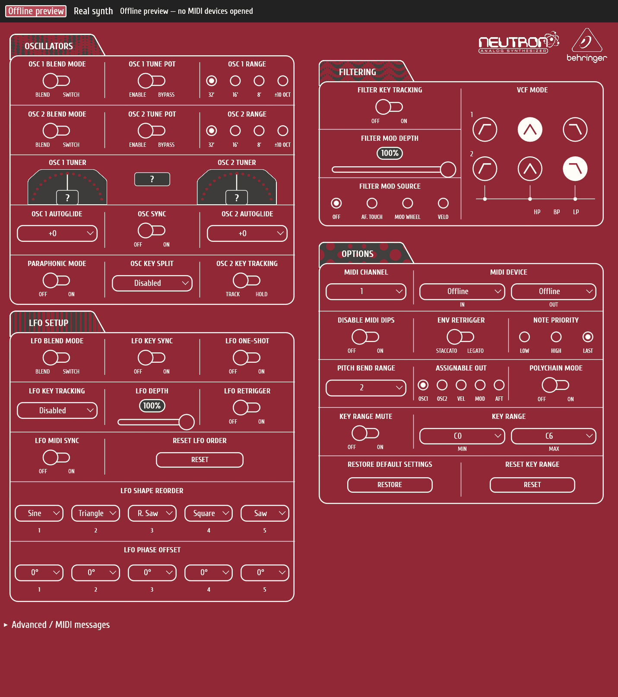

# Neutron Linux

A native Rust desktop controller for the **Behringer Neutron** synthesizer, reconstructed from the Neutron 1.0.3 application. The interface follows the original instrument-panel design, with burgundy panels, white controls, original artwork and Cuprum typography.



## Features

- Oscillator, LFO, filter, MIDI and keyboard settings.
- Native Linux MIDI input/output through ALSA, using `midir`.
- Firmware handshake, settings readback and a bounded MIDI message log.
- Waveform-order and phase controls, reset actions and confirmed settings restore.
- Analog tuner displays driven by incoming tuning telemetry.
- Offline preview that opens no MIDI devices.
- Responsive native GUI built with `egui`/`eframe`.

The GUI, state, MIDI transport and SysEx handling run in Rust. The protocol data, fonts and artwork are embedded in the executable. No Python, JavaScript, browser, Electron, Wine or Proton is required at runtime.

## Build and run

Requires Rust 1.99 or newer for the checked-in dependency set, ALSA development headers, `pkg-config`, and a working Linux graphics environment.

On Fedora:

```sh
sudo dnf install gcc pkgconf-pkg-config alsa-lib-devel
```

On Debian/Ubuntu:

```sh
sudo apt install build-essential pkg-config libasound2-dev
```

Then:

```sh
git clone https://github.com/zwaffell/neutron-linux.git
cd neutron-linux
cargo build --release --locked
./target/release/neutron-linux
```

The executable starts in **Offline preview**. Edits change local values and show their MIDI packets without opening devices. Offline settings reset when you restart or return to preview.

For hardware, select **Real synth**, click **Refresh MIDI ports**, select the input and output for the same Neutron in the Options panel, then click **Connect**. Controls become available after the firmware handshake and settings readback. Changes then send MIDI immediately to the selected synth. A six-second response timeout disconnects it.

The recovered application requires firmware **2.0.2 or later**, and also accepts its major-zero development-version convention. Note names follow the original keyboard convention: MIDI note 24 is C0. Offline values are the original renderer's initial values, not measured hardware factory defaults.

## Validation and current limits

```sh
cargo fmt --check
cargo test --release --locked
./target/release/neutron-linux --smoke-test
```

All **15 tests** passed on the development machine. They cover known MIDI packets, bitfield transforms, SysEx packing, malformed inputs, firmware checks, settings/tuner decoding, offline behavior, custom-widget pointer interactions, and narrow-window layout. The native application was also opened and visually checked in offline mode.

**Real hardware communication has not yet been validated.** Discovery, parameter readback and tuner delivery still need a real-device test. The app decodes tuner telemetry but does not generate simulated frequencies or send calibration/factory-reset commands.

This is a Linux desktop application, not a universally static binary. A built executable still needs compatible standard Linux audio, graphics and C runtime libraries.

## Project layout

- `src/main.rs`: application state, MIDI message processing and entry point.
- `src/instrument.rs`: instrument-panel layout and native controls.
- `src/midi.rs`: ALSA MIDI discovery and connections.
- `src/protocol.rs`: SysEx encoding, settings parsing and validation.
- `src/spec.json`: embedded recovered parameter map.
- `assets/`: embedded fonts and artwork.
- `docs/PROTOCOL.md`: reverse-engineering findings and provenance.
- `packaging/`: application-menu entry and icon.

The historical protocol notes reference the original analysis workspace and its recovered source listings; those listings and the Windows installer are not included in this source repository.

## Attribution

This is an unofficial project and is not affiliated with or endorsed by Behringer. Original branding and UI artwork retain their respective ownership. Font and asset provenance is recorded in [THIRD_PARTY.md](THIRD_PARTY.md); no blanket license is asserted for the vendor artwork.
